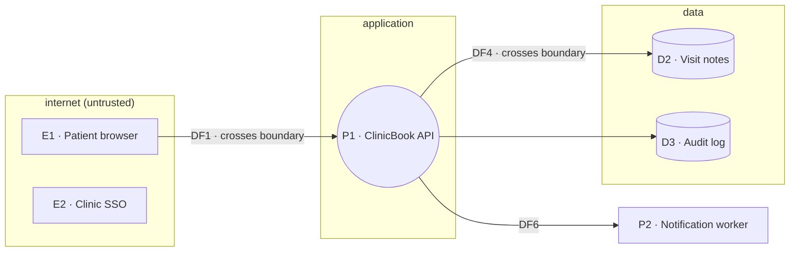

[](https://github.com/Icedmango83/exercises/actions/workflows/tests.yml)


# STRIDE-per-element engine

A small threat-modeling tool. It reads a system's **data-flow diagram** as JSON, decides which **STRIDE** threats must be checked for every element, and prints a checklist with the **flows that cross a trust boundary first**, because that's where most threats live.

```
$ python3 stride.py clinicbook.json
DF1   [boundary]  D I T
DF4   [boundary]  D I T
E1                R S
E2                R S
P1                D E I R S T
D2                D I T
D3                D I R T
DF6               D I T

26 checks in total
```

## The system it models

`clinicbook.json` describes **ClinicBook**, a fictional clinic booking app:



## The rule it applies: STRIDE-per-element

Each type of diagram element can only suffer certain threats:

| Element type | Letters | Why |
|---|---|---|
| External entity | **S R** | someone can pretend to be it, or it can deny an action |
| Process | **S T R I D E** | code that acts can be attacked in every way |
| Data store | **T I D** (+ **R** if it holds logs) | data at rest can be changed, read or made unavailable |
| Data flow | **T I D** | data in transit can be changed, read or blocked |

STRIDE = **S**poofing · **T**ampering · **R**epudiation · **I**nformation disclosure · **D**enial of service · **E**levation of privilege.

## How it's built

| Function | Job |
|---|---|
| `threats_for(element)` | letters for one element; copies the rule table and raises `ValueError` on unknown types |
| `prioritize(model)` | element IDs, boundary-crossing flows first, file order kept |
| `format_line(id, boundary, letters)` | one fixed-width report line |
| `total_checks(model)` | how many checks the whole system needs |
| `main(path)` | loads the JSON and prints the report (only when run directly) |

## Two bug classes it guards against

1. **Shared state.** Adding `R` to the rule table itself (instead of a copy) would silently give every later store an `R`. Guarded by `test_store_order_does_not_leak`.
2. **Presence vs value.** `"holds_logs" in element` is true even for `"holds_logs": false`. The tool reads the value with `.get("holds_logs", False)`. Guarded by `test_holds_logs_false_means_no_r`.

## Run it

```bash
python3 stride.py clinicbook.json
python3 -m pytest
```

Requires Python 3.10+ (no dependencies) and `pytest` for the tests.
